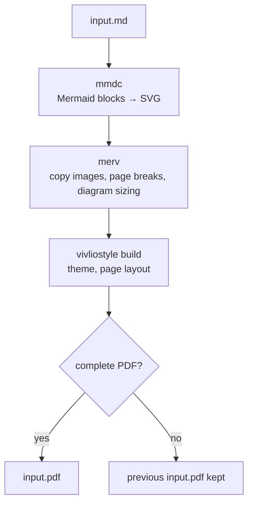

# Merv

Markdown with Mermaid → themed PDF, via
[`@mermaid-js/mermaid-cli`](https://github.com/mermaid-js/mermaid-cli) and
[`@vivliostyle/cli`](https://github.com/vivliostyle/vivliostyle-cli).

No [Marp](https://marp.app/)-style `---` slide markers — layout is automatic. For a manual page break, write `<!-- pagebreak -->`.

`merv` = `mer`maid + `v`ivliostyle.

## Usage

```sh
npx @noooooooode/merv input.md && open input.pdf
```

Or

```sh
npm install -g @noooooooode/merv
merv input.md && open input.pdf
```

Needs Node.js **>= 22.13.0**, the floor `@mermaid-js/mermaid-cli` sets.

Both tools underneath draw pages with a headless Chrome, which Puppeteer
downloads on install into `~/.cache/puppeteer` — around 650 MB, and the reason
the first run is a slow one. It is shared between projects and reused after
that.

### Options

```text
Usage: merv [options] [--] input.md
       merv -v | --version
       merv -h | --help

Options:
  -T, --theme       Vivliostyle theme (default: @vivliostyle/theme-techbook)
  -o, --output      Output PDF path (default: <input>.pdf)
  --config <file>   Use this config instead of searching for one
  --no-config       Use no config
  --keep-work-dir   Keep the intermediate files and print where they are
  --verbose         Print the config used, and each tool's arguments and cwd
  -v, --version     Show version
  -h, --help        Show this help
  --                Take what follows as the input, even if it starts with -

Themes:
  https://docs.vivliostyle.org/en/themes/gallery/

Markup:
  <!-- pagebreak -->   Start a new page here

Config, named merv.json or .merv.json (first one found wins, unless --config):
  ./
  <input's directory>/
  $XDG_CONFIG_HOME/merv/
  $HOME/

  {"mermaid": ["-t", "dark"], "vivliostyle": ["--press-ready"]}
```

`mermaid-cli` and `vivliostyle` output is streamed through as-is.

A failed build leaves an existing PDF at the output path untouched: the new
PDF is checked for a header and end marker before it replaces the old one.

`--keep-work-dir` leaves the intermediate files in place — the Markdown
`mermaid-cli` produced, the diagrams, and the copied images — and prints the
directory, which is the place to look when a PDF comes out wrong.

An image or other local file the document points at but `merv` cannot find
next to it is reported on stderr. The build still goes ahead, since the PDF
is otherwise fine, so watch for the warning.

### Local themes and stylesheets

`-T ./my-theme.css`, and paths in a config's `-T`, `--style` and
`--user-style`, are resolved against the current directory, the same as the
paths `mermaid-cli` is given. A stylesheet file is copied in alongside the
document, so one that pulls in other files by relative path — `@import`,
fonts, background images — loses them. Give such a theme as a directory with
a `package.json` instead, which `vivliostyle` installs whole.

### Page breaks

Write `<!-- pagebreak -->` to start a new page there:

```md
The end of one page.

<!-- pagebreak -->

The start of the next.
```

The marker is matched case-insensitively, works with any theme, and is
ignored inside code — fenced or indented blocks and code spans. A marker
with nothing before it on its page — at the start of the document, or right
after another marker — is dropped rather than leaving a blank page.

### Diagrams

A diagram cannot be split across pages, so one taller than a page is shrunk
to fit on a single page, at the cost of smaller text.

## Configuration

Options `merv` does not have of its own are reached through a `merv.json` or
`.merv.json`, which passes arguments straight to the two tools underneath:

```json
{
  "mermaid": ["-t", "dark", "-b", "transparent"],
  "vivliostyle": ["--press-ready", "-s", "B5"]
}
```

Both keys are optional. Filenames and search order:

1. Current directory
2. Directory of the input file
3. `$XDG_CONFIG_HOME/merv/` (fallback: `~/.config/merv/`)
4. `$HOME`

- **First match wins** — later files are ignored, not merged.
- `--config <file>` uses that file and searches no further; `--no-config`
  uses none. A `--config` file that does not exist is an error, not a reason
  to fall back to the search.
- Config args are appended after `merv`'s own, so where the last occurrence
  wins, the config wins — including over `-T` on the command line.
- `-o` is the exception: `vivliostyle` takes each one as another output, so a
  `-o` in the config writes a copy there as well, each `-o` followed by an
  optional `-f` for its format. Only `merv`'s own output is kept safe when a
  build fails; these are written by `vivliostyle` directly. An `-o` without an
  extension is a webpub directory, which `vivliostyle` empties first, so one
  that holds the current directory or the input is refused.
- Relative paths in a config are resolved against the current directory, not
  the directory the config sits in — the same rule `mermaid-cli` follows for
  its arguments and `vivliostyle` for its own `vivliostyle.config.js`. A
  config in `$HOME` or `$XDG_CONFIG_HOME` that names a file should use an
  absolute path.

Treat a `merv.json` from a cloned repository like any other executable
content: it sets arguments for the browser-driving tools `merv` runs.

## Input documents

Only convert Markdown you trust. Raw HTML in it, scripts included, is rendered
by a headless Chrome that can read local files `merv` can read and reach
external URLs.

## Troubleshooting

### Chrome fails to start on Linux

Ubuntu 23.10 and later restrict unprivileged user namespaces, which Chrome's
sandbox needs, so Chrome can fail to launch even with every shared library
installed. The error usually mentions the sandbox or `No usable sandbox!`.
The fix needs root, such as an AppArmor profile for Puppeteer's Chrome; see
[Puppeteer's troubleshooting guide](https://pptr.dev/troubleshooting).
`merv` does not change these settings for you.

## How it works

Each run works in a private directory of its own, and only a PDF that came out
whole replaces the one at the output path:



## License

[MIT](LICENSE)
