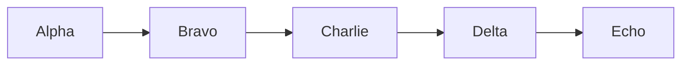

# Second

A second document, deliberately longer than `sample.md` so that a build of one
can be told apart from a build of the other by output size alone.

## Filler

Vivliostyle lays this out over several pages, which makes the resulting PDF
clearly larger than the one produced from the single-diagram sample.

- Alpha
- Bravo
- Charlie
- Delta
- Echo
- Foxtrot
- Golf
- Hotel
- India
- Juliett

### Paragraphs

The quick brown fox jumps over the lazy dog. The quick brown fox jumps over the
lazy dog. The quick brown fox jumps over the lazy dog. The quick brown fox jumps
over the lazy dog. The quick brown fox jumps over the lazy dog.

The quick brown fox jumps over the lazy dog. The quick brown fox jumps over the
lazy dog. The quick brown fox jumps over the lazy dog. The quick brown fox jumps
over the lazy dog. The quick brown fox jumps over the lazy dog.

The quick brown fox jumps over the lazy dog. The quick brown fox jumps over the
lazy dog. The quick brown fox jumps over the lazy dog. The quick brown fox jumps
over the lazy dog. The quick brown fox jumps over the lazy dog.

The quick brown fox jumps over the lazy dog. The quick brown fox jumps over the
lazy dog. The quick brown fox jumps over the lazy dog. The quick brown fox jumps
over the lazy dog. The quick brown fox jumps over the lazy dog.
